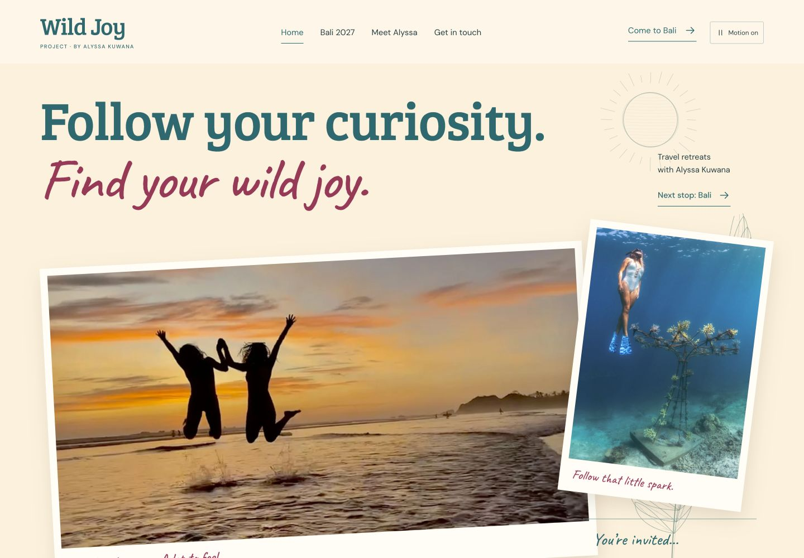
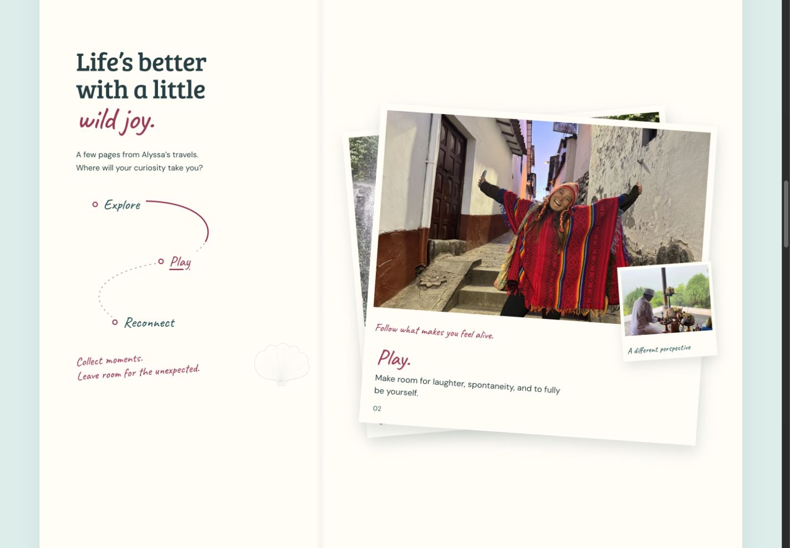

# Wild Joy Project

[Live draft](https://wild-joy-project-draft.hiro-33e.workers.dev) · [GitHub source](https://github.com/hkuwana/wild-joy-project)

A first-draft website for Alyssa Kuwana’s travel retreats: playful Bree Serif and
handwritten typography, an ocean–sand–hibiscus palette,
original photography, pencil-style SVG studies, an animated travel notebook,
scroll-linked stacks of real photo memories and original brush strokes,
a readable Bali guide, and straightforward inquiries.

**The implementation is open source (MIT). Original photographs, branding, and
copy retain their existing rights.** See [LICENSE](LICENSE) and [sources](docs/SOURCES.md).



## Run locally

Install Node.js 22 or newer. No package installation is needed for the website.

```sh
npm run dev
```

Open http://127.0.0.1:4173. After editing a file, run `npm run build` in a second
terminal and refresh the browser. Stop the preview with Ctrl-C.

```sh
npm run build
npm run check
npm test
```

The complete deployable website is generated in `dist/`. It needs no database,
server functions, external font services, analytics, or paid website builder.

## Make changes

- **Dates, room prices, trip descriptions, itinerary, FAQs, bio, contact email:** edit `content.json`.
- **Colors, spacing, type and mobile layout:** edit `site/styles.css`, `site/journal.css`, and `site/notebook.css`.
- **Page layout and shared copy:** edit `scripts/build.mjs`.
- **Photos:** replace matching files in `site/assets/`; update `docs/assets.json` for provenance.
- **Photo viewer, printing, and parallax:** edit `site/app.js`.
- **Stacking photo memories:** edit `site/memory-stack.js` and `site/notebook.css`.
- **Original pencil-style drawings and brush strokes:** edit `scripts/illustrations.mjs`; the build writes SVGs into `dist/assets/`.

In GitHub, open the file, click the pencil, edit, and commit. A commit only updates
the source: the current deployment must be redeployed separately.
Use a branch and pull request when reviewing changes with someone else.

The Contact page opens the visitor’s email app. It does not silently send mail
or store inquiries. Calendar downloads save tentative dates, not a booking.

Decorative motion follows scrolling, with smaller movement on phones. The header
control remembers the visitor’s choice. System reduced-motion settings turn the
parallax off; all content remains visible without JavaScript. The homepage notebook
contains three real-photo chapters that settle onto each other as you scroll.
The contents route marks the current chapter; scrolling back unpacks the stack.
Short screens, motion off, and reduced motion use the flowing notebook.



## Small, self-hosted animation library

The homepage uses only Motion’s scroll module (14.10.1), bundled locally at
`site/vendor/motion-scroll.js`: 9,353 bytes raw, 4,199 bytes gzip. There are no
external CDN requests or React dependency in the site. The MIT notices are kept
beside the bundle. If the library fails to load, all chapters remain readable.

The checked-in bundle keeps normal builds dependency-free. Maintainers only need
the pinned development packages to regenerate it:

```sh
npm ci
npm run vendor:motion
npm run build
npm run check
npm test
```

The vendor script and lockfile make that build reproducible. See
[Motion’s scroll documentation](https://motion.dev/docs/scroll).

## Free Cloudflare hosting

The draft uses **Cloudflare Workers Static Assets** with no Worker script.
Cloudflare documents static asset requests as free and unlimited. There is no
paid database, server-side runtime, or subscription added by this project.

### Deploy or update

```sh
npx wrangler@4.157.0 login
npm run deploy
```

Run in the Cloudflare account that owns `wild-joy-project-draft`. Configuration
is in `wrangler.jsonc`; Wrangler is pinned in the deploy command and is only a
deployment tool, not a website runtime dependency.

### Let Alyssa own hosting and connect GitHub

1. Fork this repository into Alyssa’s GitHub account (or transfer it if preferred).
2. Sign into her Cloudflare account and deploy with the commands above. She gets
   her own free `workers.dev` URL; no domain purchase is required.
3. In Workers & Pages, open the Worker’s **Settings > Builds** and connect her fork.
4. Use `main` as the production branch, `npm run build && npm run check && npm test` as the
   build command, and `npx wrangler@4.157.0 deploy` as the deploy command.
5. Keep the Worker name equal to `name` in `wrangler.jsonc`.
6. Her commits will then trigger deployments. Check the deployment result before
   treating an edit as live.

The first draft is deployed manually. GitHub-to-Cloudflare automatic deployment
is not connected, and no deployment credential is stored in this repository.
The repository’s GitHub Action only runs checks.

Add a custom domain only when Alyssa is ready. Her existing site and domain were
not changed. The generated `dist/` also works on other static hosts.

References: [Static asset pricing](https://developers.cloudflare.com/workers/static-assets/billing-and-limitations/),
[Workers Git integration](https://developers.cloudflare.com/workers/ci-cd/builds/),
[Build configuration](https://developers.cloudflare.com/workers/ci-cd/builds/configuration/).

## Before using this as the main site

Alyssa should review the prices, booking availability, photo rights, and trip
details. Keep the proposed itinerary qualification and swimming requirements.
The draft links to the existing site’s legal policies; review or migrate those
before retiring the old site.

Search indexing is disabled for the draft. Once approved, set `draft` to `false`
in `content.json`, remove `X-Robots-Tag` from `site/_headers`, and change
`site/robots.txt` to allow indexing. Then build and deploy again.

## Project structure

```text
content.json          Editable trip and host content
site/                 Styles, browser JS, photos, fonts, static hosting headers
scripts/build.mjs     Small HTML generator, no dependencies
scripts/check.mjs     Internal links, assets, critical content and calendar checks
scripts/illustrations.mjs  Original SVG botanical and ocean studies
scripts/motion.test.mjs    Motion preference and scrolling behavior checks
scripts/serve.mjs     Local preview server
docs/                 Source ledger, asset provenance, licenses and handoff
dist/                 Generated website (not committed)
```
